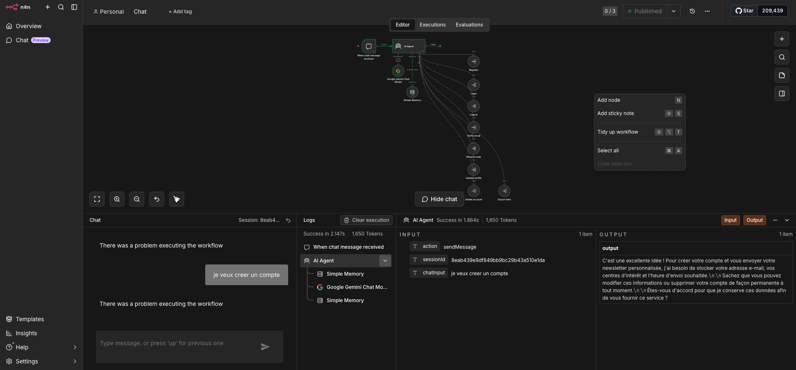

# Post-mortem: the chat stopped answering

On 3 November 2026, the `Chat` workflow showed "There was a problem executing the workflow" for every message, although the AI agent had answered. The cause was our own `make import` command, which left the `pinData` field of the imported workflows set to `null`. Fixed the same day; the fix is in commit `71cbf1f`.

## Symptom



- In the editor's test chat (left), two messages, "salut" and "je veux créer un compte", got the same error.
- In the logs panel next to it (right), the *AI Agent* succeeded (1.864 s, 1,650 tokens) and its Output holds the answer: "C'est une excellente idée ! Pour créer votre compte…". The AI had answered; the answer never reached the chat.
- The Executions tab marked the run as successful: no error was visible on the workflow side.
- Side note: the answer also shows literal `\n`, a separate issue fixed later in the prompt (see [prompt-evolution.md](prompt-evolution.md)).

## Investigation

1. **Configuration.** The Chat Trigger and the agent used default settings. Nothing unusual.
2. **n8n log** (`make logs`):
   ```text
   Error in handling webhook request POST /webhook-test/GGBGWuf3zQ2hjcbS/8eab439e…: There was a problem executing the workflow
   TypeError: Cannot read properties of null (reading 'AI Agent')
   ```
3. **n8n source code.** The function that reads the last node's output to send it back to the chat:
   ```javascript
   const { runData, pinData = {} } = inputData.data.resultData;
   // ...
   let lastNodePinData = pinData[lastNodeExecuted];
   ```
   The default value `= {}` only applies when `pinData` is missing, not when it is `null`. With `null`, the last line becomes `null['AI Agent']`: exactly the error in the log.
4. **Check.** `pinData` was `null` on 17 of the 21 workflows, and `{}` on the 4 we had saved by hand in the editor since the import.

## Root cause

Our `make export` removed the `pinData` field from the JSON files, so that test data, which may contain personal data, is never committed. On `make import`, n8n stores that missing field as `null` instead of `{}`. The code path n8n uses for test runs then reads `pinData[…]` without checking for `null`, and crashes while building the response.

Only test runs were affected (the editor's chat). Automatic runs (schedules, the unsubscribe webhook) kept working.

## Fix

| When | What | Result |
| --- | --- | --- |
| Immediate | `pinData` set to `{}` on the 17 workflows through the n8n API, without re-importing | chat working again; the 20 workflows stayed published |
| Lasting | `make import` adds `pinData: {}` to every file before importing (commit `71cbf1f`) | the JSON files of the repository do not change |
| Check | the repository imported into a temporary, fresh n8n | 21 workflows imported, none with `pinData` set to `null` |

## Lessons

- **A tool that "cleans" data must keep the expected format.** An empty object and a missing field are not the same thing for the program that reads them back.
- **Read the log before guessing.** The message in the interface was generic; the log gave the exact line.
- **Test the installation on a fresh machine, not only on your own.** That test validated the fix, and we used the same check for the next changes to the `Makefile` (`make credentials`).
